

  <picture>
    <source media="(prefers-color-scheme: dark)" srcset="images/logo-dark.png">
    
  </picture>

  <strong>Learn Python by doing, then go beyond it.</strong> 
  Short lessons, exercises graded in the browser and spaced review, 
  from your first <code>print</code> to SQL, FastAPI, Docker, Git, Django and the Claude API.

  
  
  
  
  
  

  <picture>
    <source media="(prefers-color-scheme: dark)" srcset="images/home-dark.png">
    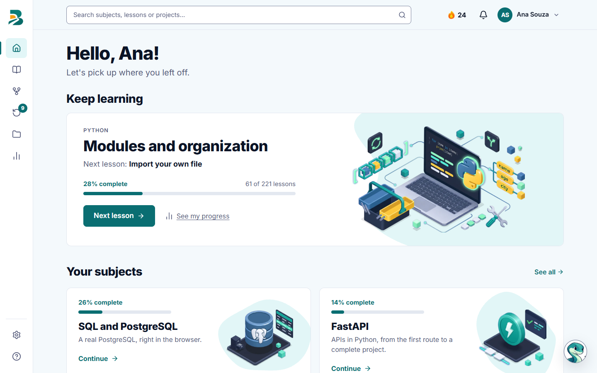
  </picture>

> **About this repository.** BeyondPy is a live product, and its source code is private. This
> repository is its public showcase: what it does, how it is built and the engineering decisions
> behind it, with screenshots and a few selected code samples. Nothing here is licensed for reuse
> (see [License](#license)).

## Why BeyondPy

Most people who start learning to code stop at one of two moments: when they **begin**, and when they
**come back after a few days**. BeyondPy is designed around those two moments:

- **A small first step.** Every lesson opens with a real problem and gets you to a working result in
  the first minutes.
- **Always know where you left off.** The home page shows the next lesson, and the review queue brings
  back what you are about to forget.
- **Learning is doing.** Every lesson ends in practice with automatic feedback that says what to try
  next, not just "wrong".
- **No pressure by design.** No rankings, timers or lost points. The one exception is a gentle streak
  flame, with 3 hearts a month that cover a missed day on their own.
- **Accessible.** Literal language, WCAG 2.2 AA, and you control theme, font size, animations and the
  mascot.

## In numbers

| | |
|---|---:|
| Subjects | **10** |
| Modules | **81** |
| Lessons | **504** |
| Graded exercises | **1,033** |
| Mutants (wrong answers the tests must reject) | **2,814** |
| Spaced-review cards | **1,601** |
| Automated tests | **about 7,000** |
| Integrated tracks (projects across subjects) | **5**, with 3 more on the way |

## What's inside

| Subject | Modules | Highlights |
|---|---:|---|
| Python | 35 | From variables to classes, typing, test doubles, asyncio, threads and packaging |
| SQL and PostgreSQL | 14 | Joins, CTEs, window functions, indexes, transactions and SQL from Python |
| FastAPI | 7 | Routes, validation, dependencies, SQLAlchemy, tokens and API tests |
| Django | 7 | Models and ORM, admin, forms, authentication, tests and a full project |
| Docker | 4 | Dockerfiles for Python, volumes, networks, Compose, health checks and security |
| Redis | 4 | Expiration, caching and invalidation, counters, rate limits and queues |
| Git and GitHub | 3 | Commits, branches, pull requests, rebase, reflog and fixing mistakes |
| Celery | 3 | Tasks, broker and worker, retries, idempotency and scheduling |
| Claude API | 3 | The first call, tools and structured output, costs and evaluations |
| Authentication | 1 | How a JWT works, from the inside |

Every lesson follows the same [12-block structure](docs/pedagogy.md#the-12-blocks), so you always know
where you are. The site is bilingual: Portuguese is the source language, and the interface and 48
modules are already in English.

## Screenshots

<table>
  <tr>
    <td width="50%">
      <picture>
        <source media="(prefers-color-scheme: dark)" srcset="images/landing-dark.png">
        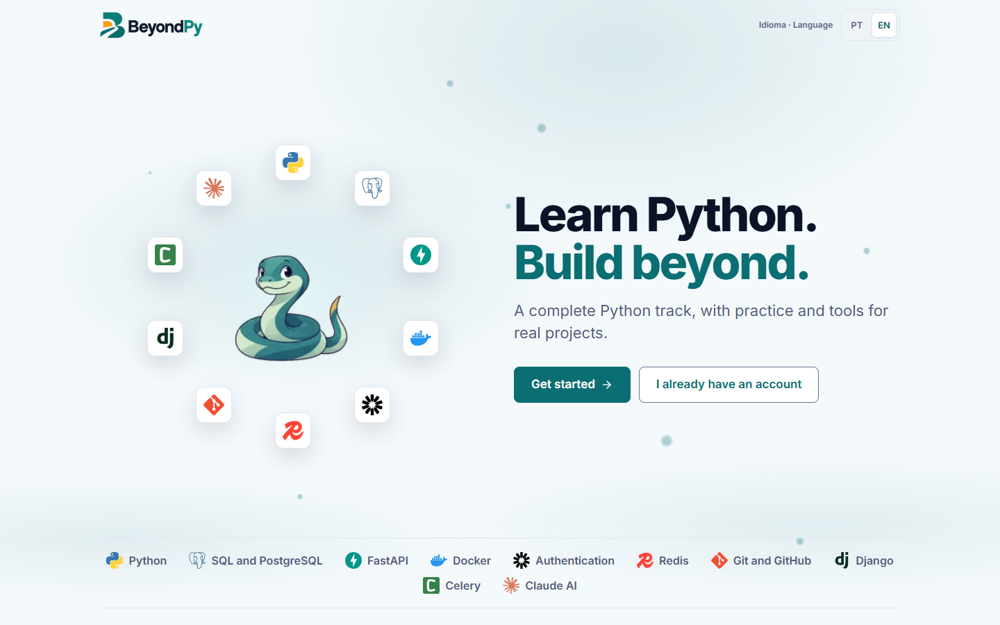
      </picture>
      
The landing page

    </td>
    <td width="50%">
      <picture>
        <source media="(prefers-color-scheme: dark)" srcset="images/lesson-dark.png">
        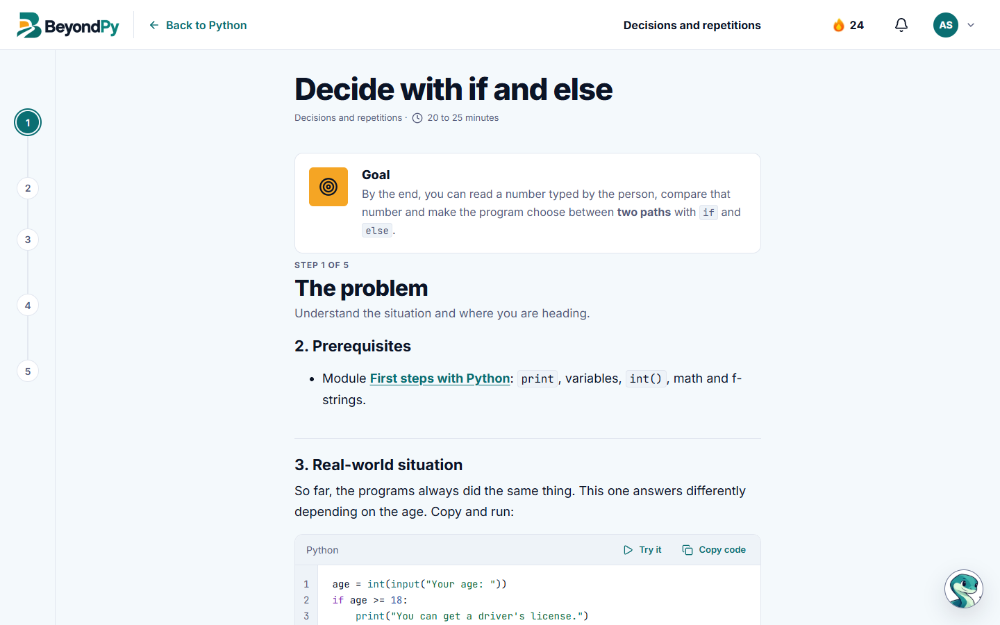
      </picture>
      
A lesson, step by step

    </td>
  </tr>
  <tr>
    <td width="50%">
      <picture>
        <source media="(prefers-color-scheme: dark)" srcset="images/exercise-python-dark.png">
        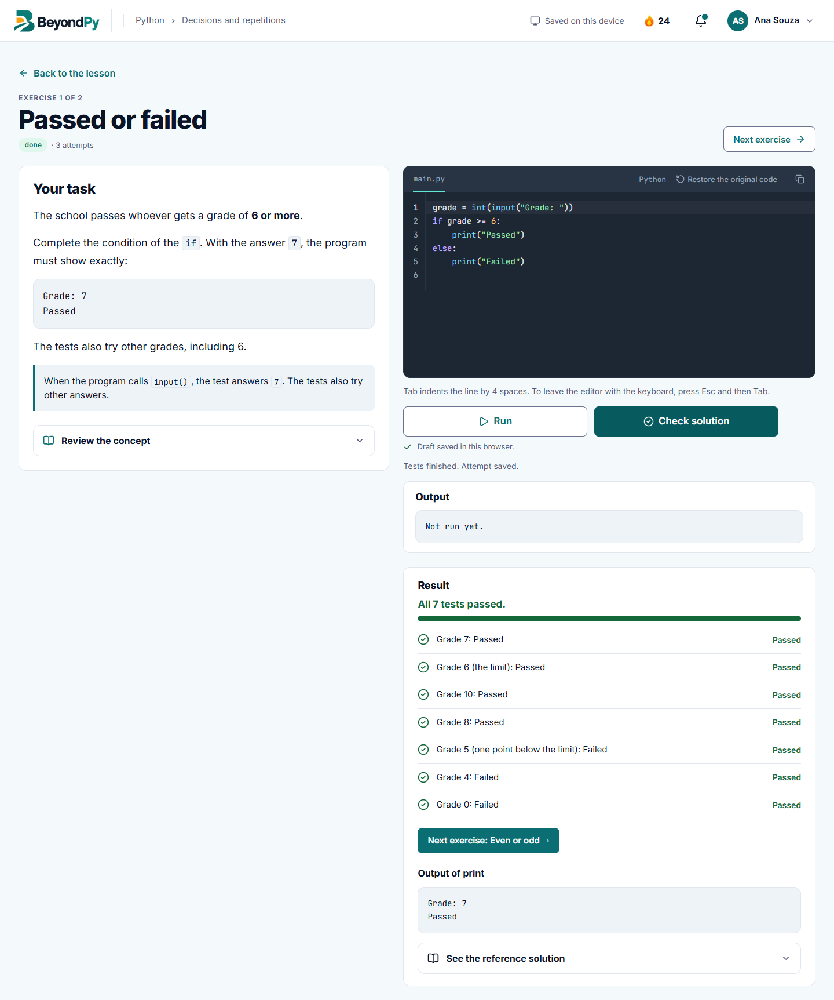
      </picture>
      
Python, graded in the browser by Pyodide

    </td>
    <td width="50%">
      <picture>
        <source media="(prefers-color-scheme: dark)" srcset="images/exercise-sql-dark.png">
        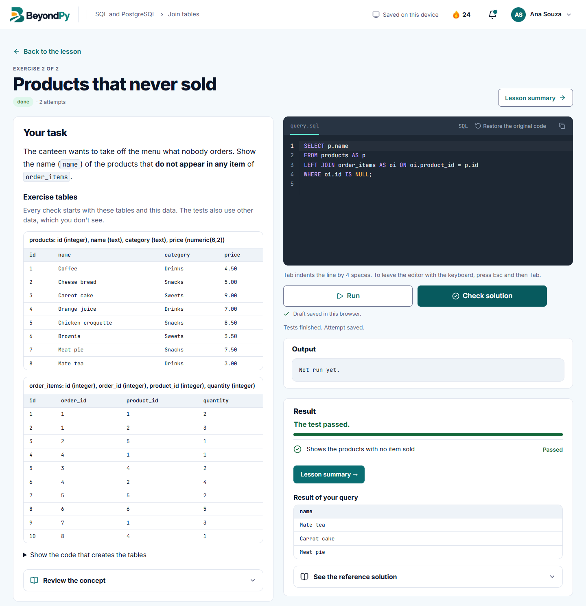
      </picture>
      
SQL, run on a real PostgreSQL inside the browser

    </td>
  </tr>
  <tr>
    <td width="50%">
      <picture>
        <source media="(prefers-color-scheme: dark)" srcset="images/exercise-git-dark.png">
        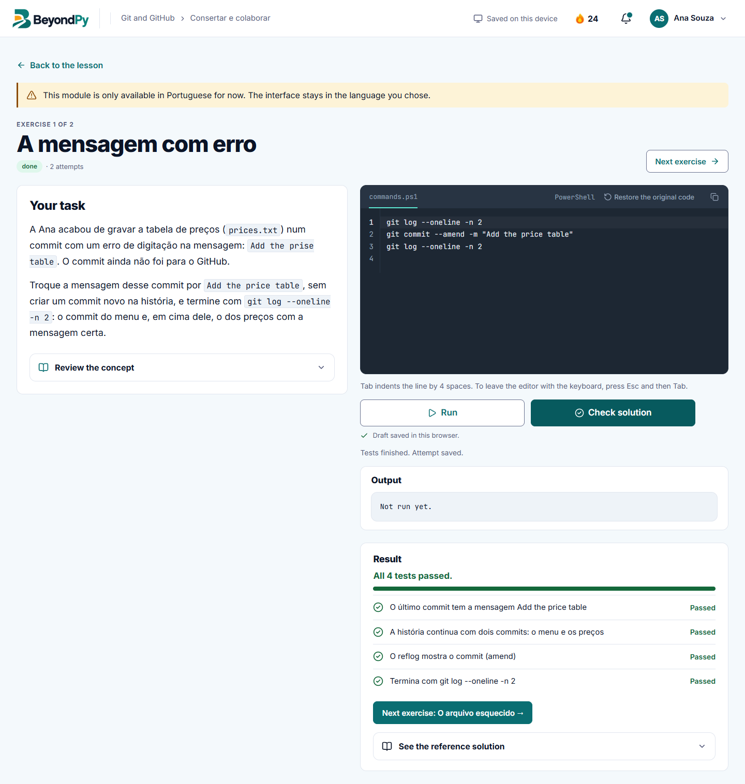
      </picture>
      
Git commands, on a simulated Git (module in Portuguese)

    </td>
    <td width="50%">
      <picture>
        <source media="(prefers-color-scheme: dark)" srcset="images/reviews-dark.png">
        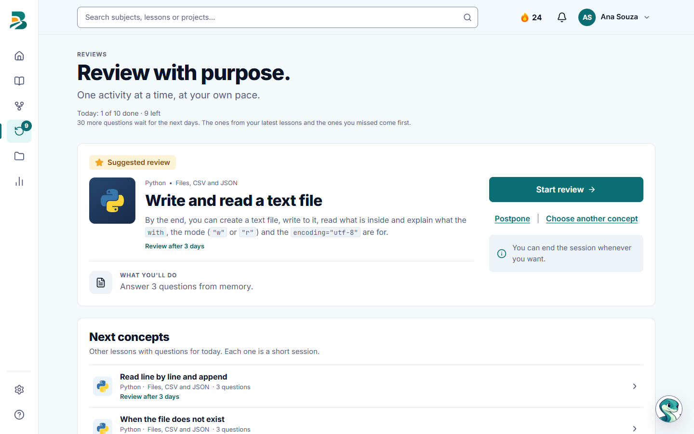
      </picture>
      
Spaced review, one lesson at a time

    </td>
  </tr>
  <tr>
    <td width="50%">
      <picture>
        <source media="(prefers-color-scheme: dark)" srcset="images/streak-dark.png">
        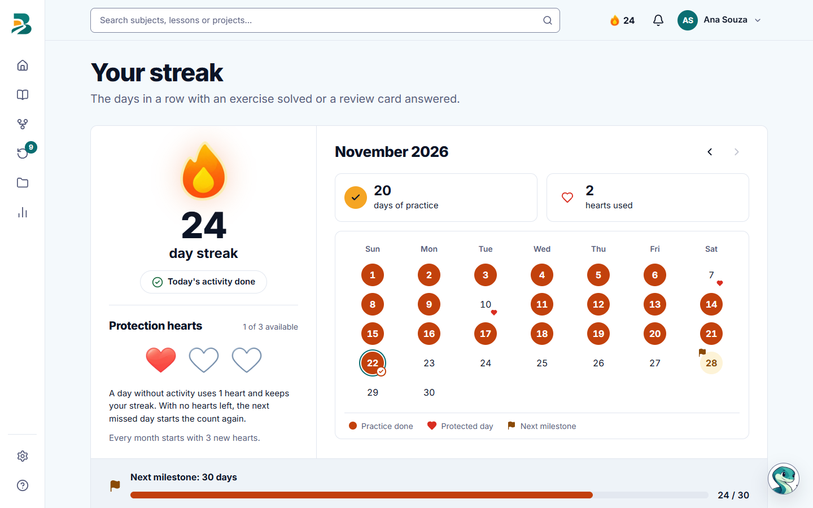
      </picture>
      
The streak, with hearts instead of punishment

    </td>
    <td width="50%">
      <picture>
        <source media="(prefers-color-scheme: dark)" srcset="images/beepy-chat-dark.png">
        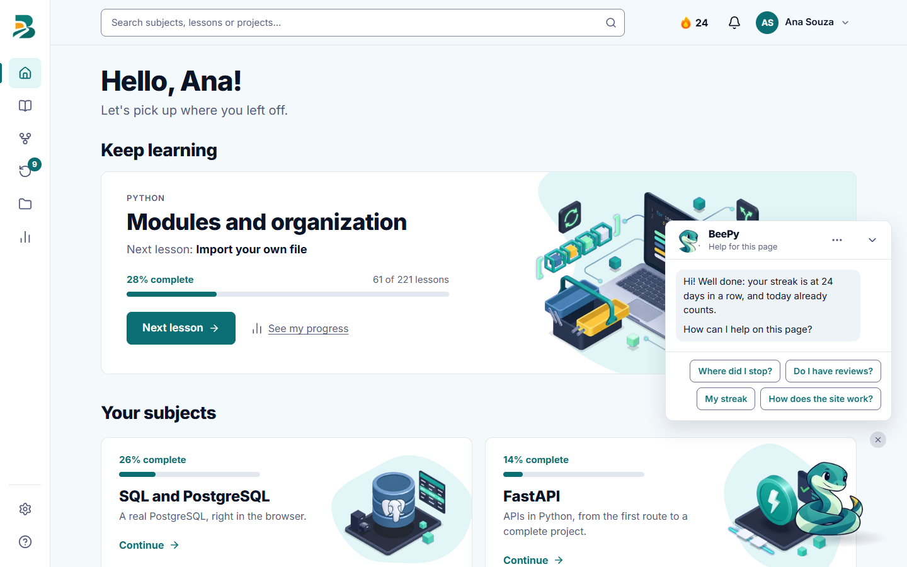
      </picture>
      
BeePy, the mascot, helps on every page

    </td>
  </tr>
  <tr>
    <td width="50%">
      <picture>
        <source media="(prefers-color-scheme: dark)" srcset="images/subject-dark.png">
        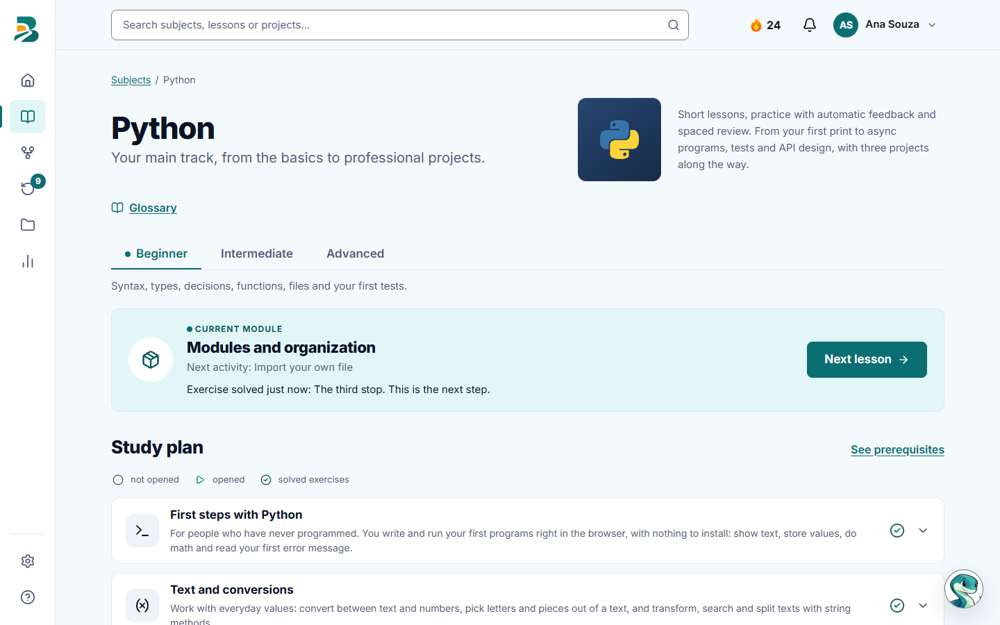
      </picture>
      
A subject, by level

    </td>
    <td width="50%" align="center">
      <picture>
        <source media="(prefers-color-scheme: dark)" srcset="images/phone-lesson-dark.png">
        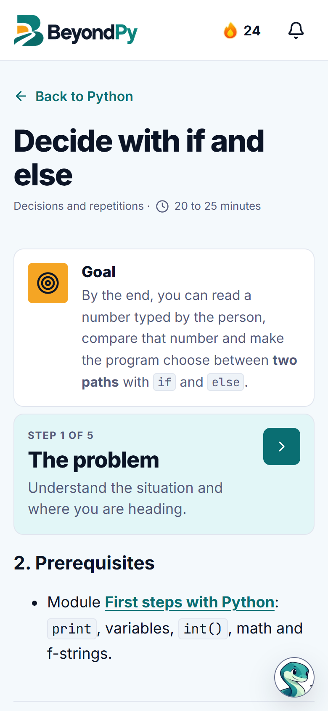
      </picture>
      <picture>
        <source media="(prefers-color-scheme: dark)" srcset="images/phone-home-dark.png">
        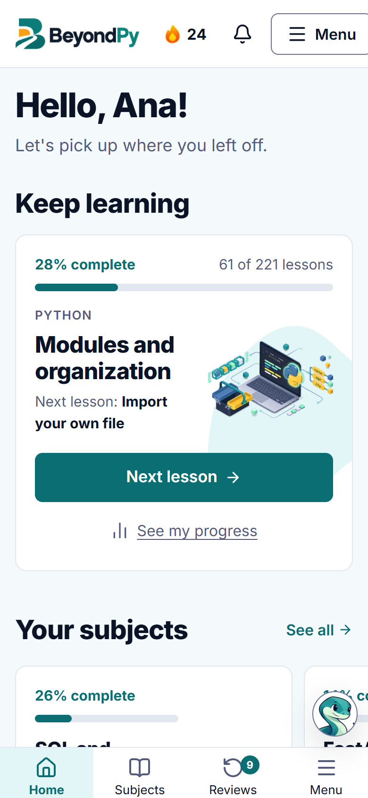
      </picture>
      
On a phone

    </td>
  </tr>
</table>

## How it is built

**Everything runs in the browser.** Exercises never run on the server. The browser runs real engines
compiled to WebAssembly, each in a Web Worker: [Pyodide](https://pyodide.org) (CPython 3.14) for
Python and [PGlite](https://pglite.dev) (PostgreSQL 18) for SQL. Tools that cannot exist in a browser,
such as `docker`, `git`, a Redis server, `alembic` and a JWT library, are simulated in pure Python, so
the student types the same commands as on a real machine.

**One grader, two places.** The same grader file runs in the browser and in `pytest`. Each exercise has
tests, a reference solution and **mutants**: typical wrong answers that the tests must reject. CI checks
every exercise: the solution passes, the starter code fails and every mutant fails.

**Parity checks.** A simulator is only useful if it behaves like the real thing. A separate workflow
runs the same cases on both sides and compares them: Pyodide against CPython, PGlite against
PostgreSQL, the Docker simulator against Docker Engine, the Git simulator against Git.

More detail:

- [Architecture](docs/architecture.md): the parts of the system and the path of one exercise.
- [Engineering](docs/engineering.md): the hard problems and how they were solved.
- [Pedagogy](docs/pedagogy.md): the learning method behind every screen.
- [Code samples](snippets/): one complete exercise with its mutants, the spaced review schedule, a
  piece of the Git simulator and the CI test selector.

## Tech stack

| Layer | Technology |
|---|---|
| Server | FastAPI, Jinja2 templates rendered on the server |
| Database | PostgreSQL 17, SQLAlchemy 2, Alembic, psycopg 3 |
| In the browser | Pyodide, PGlite, Web Workers, CodeMirror, plain JavaScript and CSS |
| Content | YAML and Markdown files; code colored by Pygments on the server |
| Accounts | Argon2 password hashes, server-side sessions, Google sign-in, Cloudflare Turnstile |
| Hosting | Railway (Docker), Cloudflare, Resend for e-mail, daily encrypted backups |
| Tooling | uv, pytest, Ruff, GitHub Actions |

## Status

BeyondPy is **live at [beyondpy.com](https://beyondpy.com)** as an invite-only beta since November
2026. The catalog is open to everyone; lessons and exercises need an account.

## Support the project

BeyondPy is built and maintained by one developer. If you want to help it grow, open to everyone,
you can [sponsor it on GitHub](https://github.com/sponsors/ilucasoliveira).

For partnerships, investment or job opportunities:

- **E-mail:** [lucasoliveirapimentel.dev@gmail.com](mailto:lucasoliveirapimentel.dev@gmail.com)
- **LinkedIn:** [linkedin.com/in/ilucasoliveira](https://www.linkedin.com/in/ilucasoliveira)
- **GitHub:** [@ilucasoliveira](https://github.com/ilucasoliveira)

## License

Copyright © 2026 Lucas Oliveira. All rights reserved. See [LICENSE](LICENSE).

The screenshots, texts and code samples in this repository are shown for evaluation only. The
BeyondPy name, logo, the BeePy mascot and the site illustrations are not licensed for any use.
