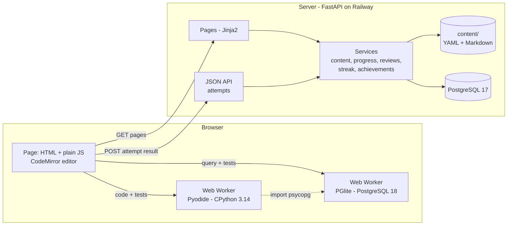

# Architecture

BeyondPy is a server-rendered web app with a heavy client side: the server owns accounts, content and
progress, and the browser owns code execution.

## The big picture

## The parts

| Part | What it does |
|---|---|
| **Pages** | FastAPI routes render Jinja2 templates. Every page works without JavaScript for reading; JavaScript adds the editor, the grader and small interactions. |
| **Content** | 81 modules live as files: `module.yaml`, lessons in Markdown, one folder per exercise (task, tests, solution, mutants) and the review cards. They are read from disk and cached by file modification time, so editing a lesson needs no deploy step besides the file itself. |
| **Grader** | One Python file, `runner.py`. In the browser it runs inside Pyodide; in CI it runs under `pytest`. SQL has a twin in JavaScript with the same rules. |
| **Simulators** | Small, pure-Python versions of tools that cannot run in a browser: Docker and Docker Compose, Git (with a PowerShell subset), a Redis server, `psycopg`, `alembic` and PyJWT. Django and Celery are real, installed in the browser as wheels built for it. |
| **Services** | Progress, spaced review, streak, achievements, notes, preferences and data export. Each request sees only the rows of its own account (see [Engineering](engineering.md#data-isolation-per-account)). |
| **Database** | PostgreSQL 17 with SQLAlchemy 2 and Alembic migrations. It stores accounts, attempts, lesson views, review states and logs, notes and notifications. Never the content. |

## The path of one exercise

1. The server reads the exercise from `content/` and renders the page.
2. The student writes code in the editor and clicks **Check solution**.
3. The page sends the code, the tests and any data files to a Web Worker.
4. The worker runs the grader (Pyodide) or the SQL grader (PGlite) and returns one result per test,
   each with a message that says what to try next.
5. The page shows the result and posts it to `/api/attempts`.
6. The server stores the attempt; progress, the streak and achievements read from it, and the next
   step appears.

The server never executes student code. That keeps hosting cheap (one small container) and removes a
whole class of security problems.

## Hosting

| Piece | Choice |
|---|---|
| App | One Docker container on Railway, built from the project's own Dockerfile |
| Database | PostgreSQL on Railway |
| Domains and edge | `beyondpy.com` and `beyondpy.com.br` behind Cloudflare |
| E-mail | Resend: password reset, e-mail confirmation and an opt-in daily practice reminder |
| Backups | A scheduled job runs `pg_dump` every day, encrypts it with `age` and stores it off-site; a monthly job restores the latest copy to prove it works |
| CI | GitHub Actions; deploys wait for CI to pass |
